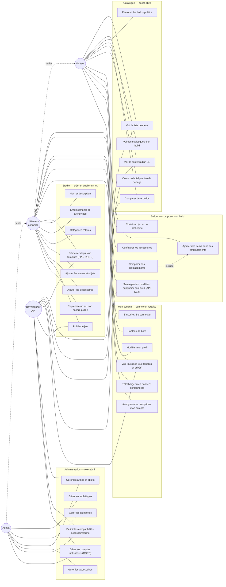
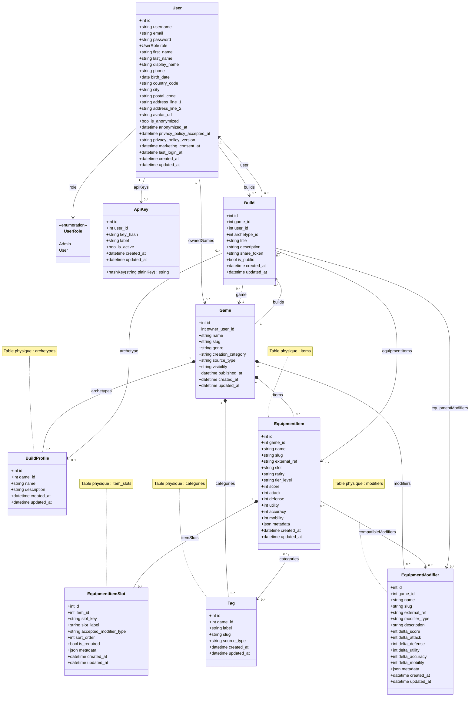
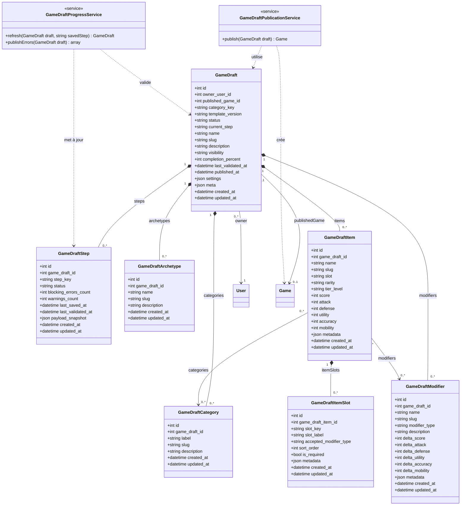
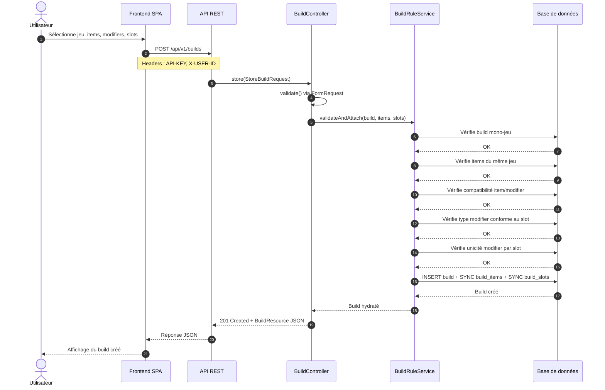
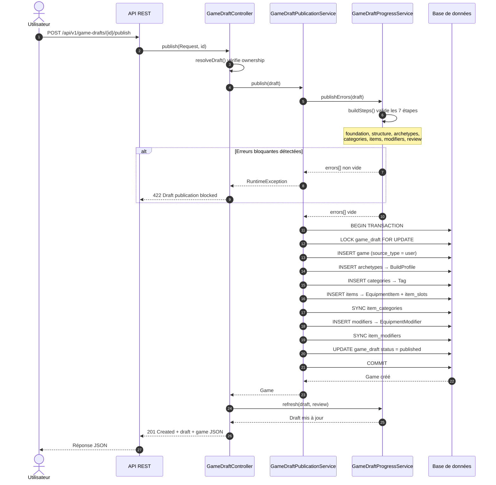
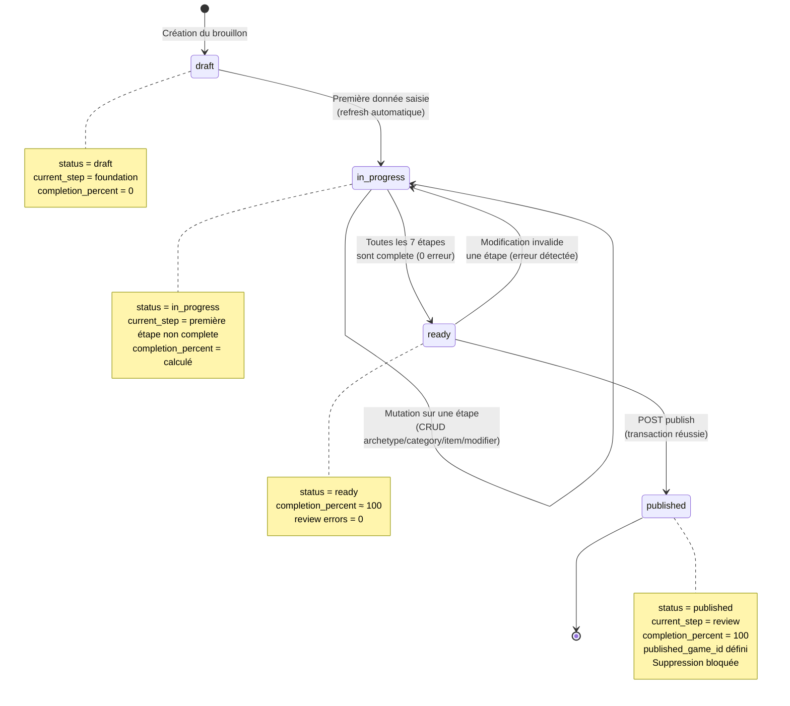
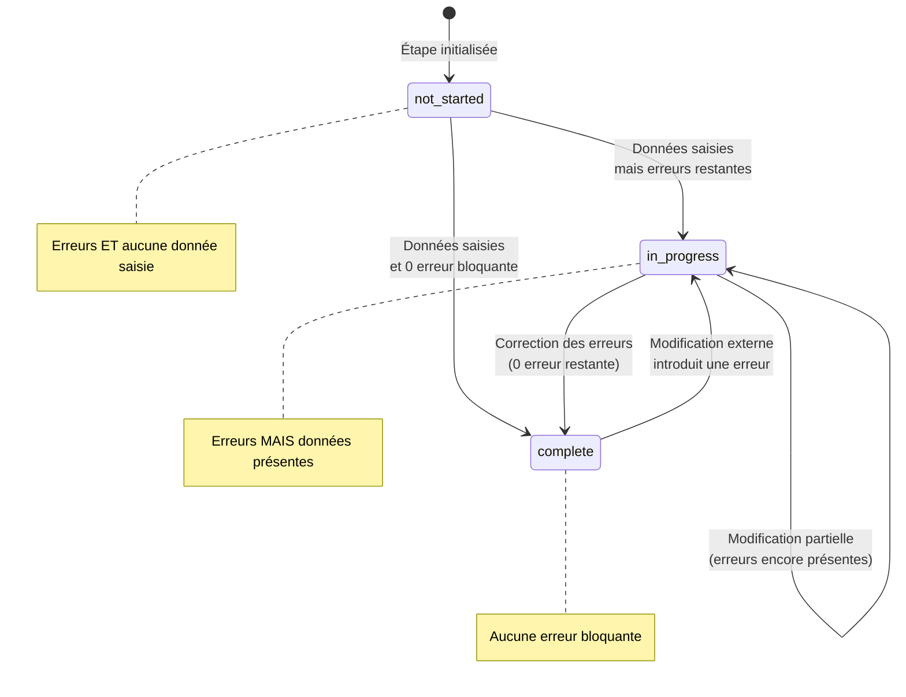
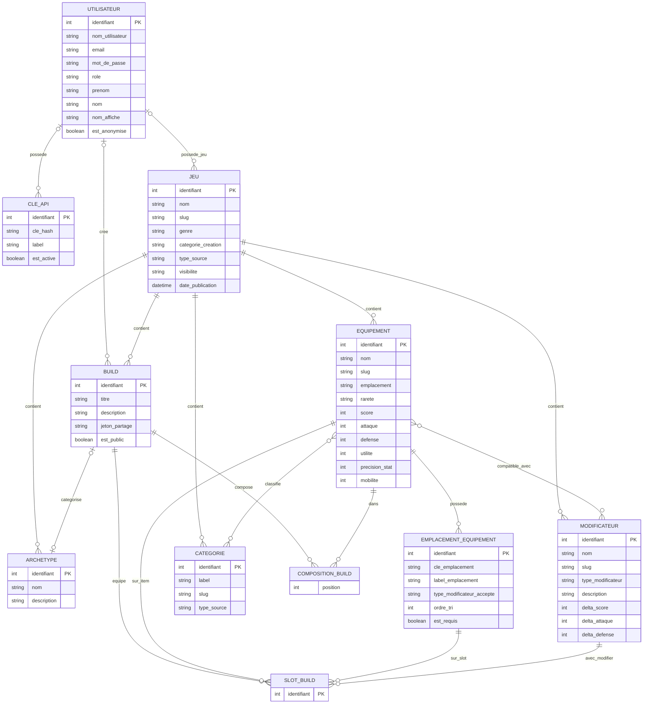
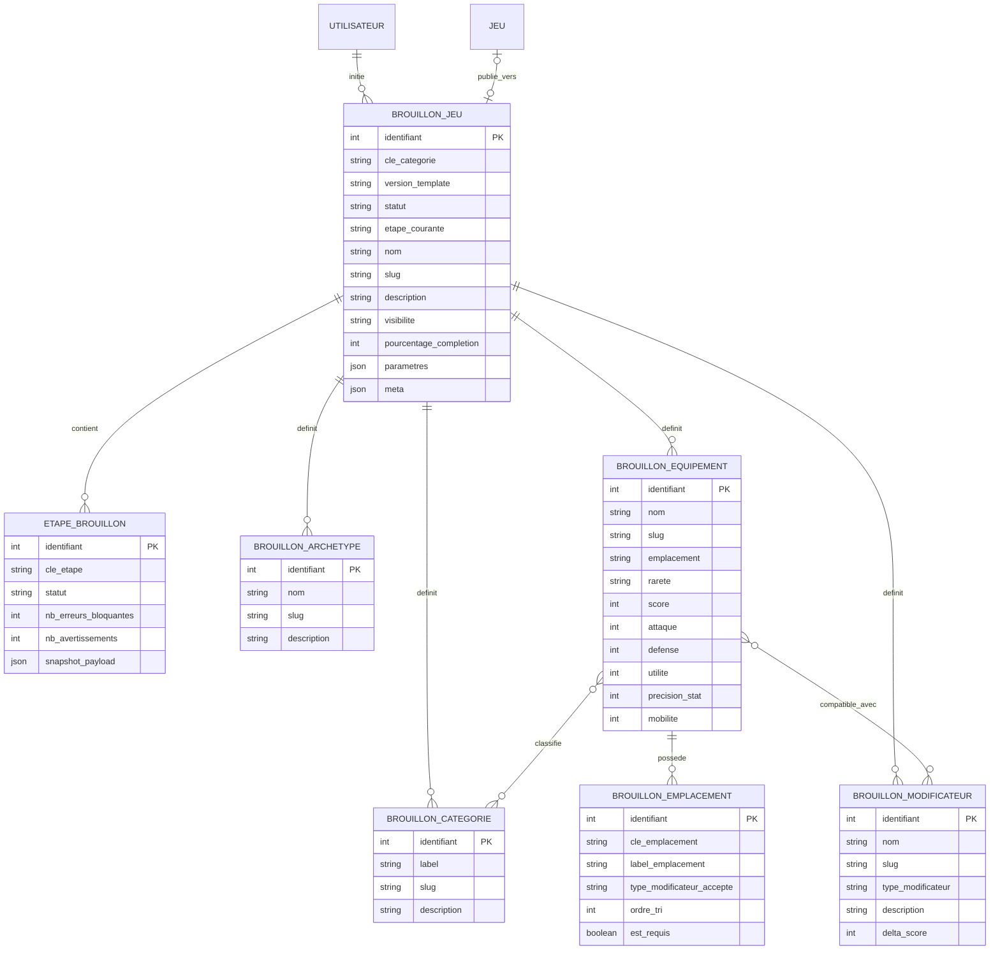

# Diagrammes UML et Base de Données — API Wiki Builder

> Diagrammes Mermaid — conformes aux normes UML 2.5 et Merise.
> Rendus compatibles GitHub, GitLab, VSCode (extension Mermaid Preview).

---

## Table des matières

1. [Diagramme de cas d'utilisation](#1-diagramme-de-cas-dutilisation)
2. [Diagramme de classes UML](#2-diagramme-de-classes-uml)
3. [Diagrammes de séquence](#3-diagrammes-de-séquence)
4. [Diagrammes d'états-transitions](#4-diagrammes-détats-transitions)
5. [MCD — Modèle Conceptuel des Données](#5-mcd--modèle-conceptuel-des-données-merise)
6. [MLD — Modèle Logique des Données](#6-mld--modèle-logique-des-données-merise)
7. [LDD — Langage de Définition des Données](#7-ldd--langage-de-définition-des-données-sql-ddl-mysql-80)

---

## 1. Diagramme de cas d'utilisation

Quatre acteurs : **Administrateur** hérite de **Utilisateur connecté** qui hérite de **Visiteur**. Le **Développeur API** accède aux routes `/api/v1/*` directement via Postman ou cURL.



---

## 2. Diagramme de classes UML

### 2.1 Domaine Runtime (données publiées)



**Pivots associatifs :**

| Pivot | Entités reliées | Attributs pivot |
|---|---|---|
| `item_categories` | EquipmentItem ↔ Tag | — |
| `item_modifiers` | EquipmentItem ↔ EquipmentModifier | — |
| `build_items` | Build ↔ EquipmentItem | `position` |
| `build_slots` | Build × EquipmentItem × EquipmentItemSlot × EquipmentModifier | — |

> `build_slots` est une **association quaternaire** : dans tel build, sur tel item, tel slot est occupé par tel modifier.

### 2.2 Domaine Draft (création de jeu par l'utilisateur)



**Pivots associatifs Draft :**

| Pivot | Entités reliées |
|---|---|
| `game_draft_item_categories` | GameDraftItem ↔ GameDraftCategory |
| `game_draft_item_modifiers` | GameDraftItem ↔ GameDraftModifier |

---

## 3. Diagrammes de séquence

### 3.1 Création d'un build



### 3.2 Publication d'un brouillon de jeu



---

## 4. Diagrammes d'états-transitions

### 4.1 Cycle de vie du GameDraft



### 4.2 Cycle de vie d'un GameDraftStep



**Étapes séquentielles (step_keys) :**

| Ordre | Clé | Objet |
|:---:|---|---|
| 1 | `foundation` | Nom, slug, description, visibilité |
| 2 | `structure` | Slots autorisés, types de modifiers, options |
| 3 | `archetypes` | Archétypes du jeu (si activés) |
| 4 | `categories` | Catégories (minimum 2) |
| 5 | `items` | Items avec slots, catégories, stats |
| 6 | `modifiers` | Modificateurs avec compatibilités |
| 7 | `review` | Synthèse de toutes les erreurs |

---

## 5. MCD — Modèle Conceptuel des Données (Merise)

> **Note :** Le MCD Merise pur ne comporte ni types, ni clés étrangères. Les types sont néanmoins indiqués ici pour satisfaire la syntaxe Mermaid `erDiagram`. Les associations avec attributs (build_items, build_slots) sont modélisées en entités associatives, faute de support natif dans Mermaid.

### 5.1 Domaine Runtime



### 5.2 Domaine Draft



---

## 6. MLD — Modèle Logique des Données (Merise)

> Convention : **gras** = clé primaire, `#` = clé étrangère, `?` = nullable.

### 6.1 Domaine Runtime

**users** (**id**, username `UNIQUE`, email `UNIQUE`, password?, remember_token?, role, first_name?, last_name?, display_name?, phone?, birth_date?, country_code?, city?, postal_code?, address_line_1?, address_line_2?, avatar_url?, is_anonymized, anonymized_at?, privacy_policy_accepted_at?, privacy_policy_version?, marketing_consent_at?, last_login_at?, created_at, updated_at)

**api_keys** (**id**, #user_id? → users(id), key_hash `UNIQUE`, label?, is_active, created_at, updated_at)

**games** (**id**, #owner_user_id? → users(id), name `UNIQUE`, slug `UNIQUE`, genre?, creation_category?, source_type, visibility, published_at?, created_at, updated_at)

**archetypes** (**id**, #game_id → games(id), name, description?, created_at, updated_at) `UNIQUE(game_id, name)`

**items** (**id**, #game_id → games(id), name, slug, external_ref?, slot, rarity, tier_level?, score, attack?, defense?, utility?, accuracy?, mobility?, metadata?, created_at, updated_at) `UNIQUE(game_id, slug)`

**item_slots** (**id**, #item_id → items(id), slot_key, slot_label, accepted_modifier_type?, sort_order, is_required, metadata?, created_at, updated_at) `UNIQUE(item_id, slot_key)`

**modifiers** (**id**, #game_id → games(id), name, slug, external_ref?, modifier_type, description?, delta_score, delta_attack?, delta_defense?, delta_utility?, delta_accuracy?, delta_mobility?, metadata?, created_at, updated_at) `UNIQUE(game_id, slug)`

**categories** (**id**, #game_id → games(id), label, slug, source_type, created_at, updated_at) `UNIQUE(game_id, slug)` `UNIQUE(game_id, label)`

**builds** (**id**, #game_id → games(id), #user_id? → users(id), #archetype_id? → archetypes(id), title, description?, share_token? `UNIQUE`, is_public, created_at, updated_at)

**item_categories** (**#item_id**, **#category_id**) → items(id), categories(id)

**item_modifiers** (**#item_id**, **#modifier_id**) → items(id), modifiers(id)

**build_items** (**#build_id**, **#item_id**, position?) → builds(id), items(id)

**build_slots** (**#build_id**, **#item_id**, **#item_slot_id**, #modifier_id) → builds(id), items(id), item_slots(id), modifiers(id) `UNIQUE(build_id, item_id, modifier_id)`

### 6.2 Domaine Draft

**game_drafts** (**id**, #owner_user_id → users(id), #published_game_id? → games(id) `UNIQUE`, category_key, template_version, status, current_step, name, slug, description?, visibility, completion_percent?, last_validated_at?, published_at?, settings?, meta?, created_at, updated_at) `UNIQUE(owner_user_id, slug)`

**game_draft_steps** (**id**, #game_draft_id → game_drafts(id), step_key, status, blocking_errors_count, warnings_count, last_saved_at?, last_validated_at?, payload_snapshot?, created_at, updated_at) `UNIQUE(game_draft_id, step_key)`

**game_draft_archetypes** (**id**, #game_draft_id → game_drafts(id), name, slug, description?, created_at, updated_at) `UNIQUE(game_draft_id, name)` `UNIQUE(game_draft_id, slug)`

**game_draft_categories** (**id**, #game_draft_id → game_drafts(id), label, slug, description?, created_at, updated_at) `UNIQUE(game_draft_id, label)` `UNIQUE(game_draft_id, slug)`

**game_draft_items** (**id**, #game_draft_id → game_drafts(id), name, slug, slot, rarity, tier_level?, score, attack?, defense?, utility?, accuracy?, mobility?, metadata?, created_at, updated_at) `UNIQUE(game_draft_id, slug)`

**game_draft_item_slots** (**id**, #game_draft_item_id → game_draft_items(id), slot_key, slot_label, accepted_modifier_type?, sort_order, is_required, metadata?, created_at, updated_at) `UNIQUE(game_draft_item_id, slot_key)`

**game_draft_modifiers** (**id**, #game_draft_id → game_drafts(id), name, slug, modifier_type, description?, delta_score, delta_attack?, delta_defense?, delta_utility?, delta_accuracy?, delta_mobility?, metadata?, created_at, updated_at) `UNIQUE(game_draft_id, name)` `UNIQUE(game_draft_id, slug)`

**game_draft_item_categories** (**#game_draft_item_id**, **#game_draft_category_id**) → game_draft_items(id), game_draft_categories(id)

**game_draft_item_modifiers** (**#game_draft_item_id**, **#game_draft_modifier_id**) → game_draft_items(id), game_draft_modifiers(id)

---

## 7. LDD — Langage de Définition des Données (SQL DDL MySQL 8.0)

> Ordre de création respectant les dépendances de clés étrangères.

### 7.1 Tables principales

```sql
-- ============================================================
-- 1. USERS
-- ============================================================
CREATE TABLE users (
    id              BIGINT UNSIGNED NOT NULL AUTO_INCREMENT,
    username        VARCHAR(80)  NOT NULL,
    email           VARCHAR(190) NOT NULL,
    password        VARCHAR(255) NULL,
    remember_token  VARCHAR(100) NULL,
    role            VARCHAR(30)  NOT NULL,
    first_name      VARCHAR(100) NULL,
    last_name       VARCHAR(100) NULL,
    display_name    VARCHAR(120) NULL,
    phone           VARCHAR(30)  NULL,
    birth_date      DATE         NULL,
    country_code    CHAR(2)      NULL,
    city            VARCHAR(120) NULL,
    postal_code     VARCHAR(20)  NULL,
    address_line_1  VARCHAR(190) NULL,
    address_line_2  VARCHAR(190) NULL,
    avatar_url      VARCHAR(255) NULL,
    is_anonymized   TINYINT(1)   NOT NULL DEFAULT 0,
    anonymized_at   TIMESTAMP    NULL,
    privacy_policy_accepted_at TIMESTAMP NULL,
    privacy_policy_version     VARCHAR(30) NULL,
    marketing_consent_at       TIMESTAMP NULL,
    last_login_at              TIMESTAMP NULL,
    created_at      TIMESTAMP    NULL,
    updated_at      TIMESTAMP    NULL,

    PRIMARY KEY (id),
    UNIQUE KEY unq_username (username),
    UNIQUE KEY unq_email (email),
    INDEX idx_role (role),
    INDEX idx_is_anonymized (is_anonymized),
    INDEX idx_country_code (country_code)
) ENGINE=InnoDB DEFAULT CHARSET=utf8mb4 COLLATE=utf8mb4_unicode_ci;

-- ============================================================
-- 2. API_KEYS
-- ============================================================
CREATE TABLE api_keys (
    id          BIGINT UNSIGNED NOT NULL AUTO_INCREMENT,
    user_id     BIGINT UNSIGNED NULL,
    key_hash    VARCHAR(64)  NOT NULL,
    label       VARCHAR(100) NULL,
    is_active   TINYINT(1)   NOT NULL DEFAULT 1,
    created_at  TIMESTAMP    NULL,
    updated_at  TIMESTAMP    NULL,

    PRIMARY KEY (id),
    UNIQUE KEY unq_key_hash (key_hash),
    INDEX idx_user_active (user_id, is_active),
    CONSTRAINT fk_api_keys_user FOREIGN KEY (user_id)
        REFERENCES users (id) ON DELETE SET NULL
) ENGINE=InnoDB DEFAULT CHARSET=utf8mb4 COLLATE=utf8mb4_unicode_ci;

-- ============================================================
-- 3. GAMES
-- ============================================================
CREATE TABLE games (
    id                  BIGINT UNSIGNED NOT NULL AUTO_INCREMENT,
    owner_user_id       BIGINT UNSIGNED NULL,
    name                VARCHAR(120) NOT NULL,
    slug                VARCHAR(120) NOT NULL,
    genre               VARCHAR(80)  NULL,
    creation_category   VARCHAR(40)  NULL,
    source_type         VARCHAR(20)  NOT NULL DEFAULT 'system',
    visibility          VARCHAR(20)  NOT NULL DEFAULT 'public',
    published_at        TIMESTAMP    NULL,
    created_at          TIMESTAMP    NULL,
    updated_at          TIMESTAMP    NULL,

    PRIMARY KEY (id),
    UNIQUE KEY unq_name (name),
    UNIQUE KEY unq_slug (slug),
    INDEX idx_owner (owner_user_id),
    INDEX idx_source_type (source_type),
    INDEX idx_visibility (visibility),
    INDEX idx_source_visibility (source_type, visibility),
    CONSTRAINT fk_games_owner FOREIGN KEY (owner_user_id)
        REFERENCES users (id) ON DELETE SET NULL
) ENGINE=InnoDB DEFAULT CHARSET=utf8mb4 COLLATE=utf8mb4_unicode_ci;

-- ============================================================
-- 4. ARCHETYPES (BuildProfile)
-- ============================================================
CREATE TABLE archetypes (
    id          BIGINT UNSIGNED NOT NULL AUTO_INCREMENT,
    game_id     BIGINT UNSIGNED NOT NULL,
    name        VARCHAR(120) NOT NULL,
    description TEXT         NULL,
    created_at  TIMESTAMP    NULL,
    updated_at  TIMESTAMP    NULL,

    PRIMARY KEY (id),
    UNIQUE KEY unq_game_name (game_id, name),
    CONSTRAINT fk_archetypes_game FOREIGN KEY (game_id)
        REFERENCES games (id) ON DELETE CASCADE
) ENGINE=InnoDB DEFAULT CHARSET=utf8mb4 COLLATE=utf8mb4_unicode_ci;

-- ============================================================
-- 5. ITEMS (EquipmentItem)
-- ============================================================
CREATE TABLE items (
    id              BIGINT UNSIGNED NOT NULL AUTO_INCREMENT,
    game_id         BIGINT UNSIGNED NOT NULL,
    name            VARCHAR(140) NOT NULL,
    slug            VARCHAR(160) NOT NULL,
    external_ref    VARCHAR(160) NULL,
    slot            VARCHAR(60)  NOT NULL,
    rarity          VARCHAR(40)  NOT NULL,
    tier_level      VARCHAR(20)  NULL,
    score           INT          NOT NULL DEFAULT 0,
    attack          INT          NULL,
    defense         INT          NULL,
    utility         INT          NULL,
    accuracy        INT          NULL,
    mobility        INT          NULL,
    metadata        JSON         NULL,
    created_at      TIMESTAMP    NULL,
    updated_at      TIMESTAMP    NULL,

    PRIMARY KEY (id),
    UNIQUE KEY unq_game_slug (game_id, slug),
    INDEX idx_game_ref (game_id, external_ref),
    INDEX idx_slot (slot),
    INDEX idx_rarity (rarity),
    INDEX idx_game_score (game_id, score),
    CONSTRAINT fk_items_game FOREIGN KEY (game_id)
        REFERENCES games (id) ON DELETE CASCADE
) ENGINE=InnoDB DEFAULT CHARSET=utf8mb4 COLLATE=utf8mb4_unicode_ci;

-- ============================================================
-- 6. ITEM_SLOTS (EquipmentItemSlot)
-- ============================================================
CREATE TABLE item_slots (
    id                      BIGINT UNSIGNED    NOT NULL AUTO_INCREMENT,
    item_id                 BIGINT UNSIGNED    NOT NULL,
    slot_key                VARCHAR(60)        NOT NULL,
    slot_label              VARCHAR(80)        NOT NULL,
    accepted_modifier_type  VARCHAR(60)        NULL,
    sort_order              SMALLINT UNSIGNED  NOT NULL DEFAULT 1,
    is_required             TINYINT(1)         NOT NULL DEFAULT 0,
    metadata                JSON               NULL,
    created_at              TIMESTAMP          NULL,
    updated_at              TIMESTAMP          NULL,

    PRIMARY KEY (id),
    UNIQUE KEY unq_item_slot (item_id, slot_key),
    INDEX idx_modifier_type (accepted_modifier_type),
    INDEX idx_item_sort (item_id, sort_order),
    CONSTRAINT fk_item_slots_item FOREIGN KEY (item_id)
        REFERENCES items (id) ON DELETE CASCADE
) ENGINE=InnoDB DEFAULT CHARSET=utf8mb4 COLLATE=utf8mb4_unicode_ci;

-- ============================================================
-- 7. MODIFIERS (EquipmentModifier)
-- ============================================================
CREATE TABLE modifiers (
    id              BIGINT UNSIGNED NOT NULL AUTO_INCREMENT,
    game_id         BIGINT UNSIGNED NOT NULL,
    name            VARCHAR(140) NOT NULL,
    slug            VARCHAR(160) NOT NULL,
    external_ref    VARCHAR(160) NULL,
    modifier_type   VARCHAR(60)  NOT NULL,
    description     TEXT         NULL,
    delta_score     INT          NOT NULL DEFAULT 0,
    delta_attack    INT          NULL,
    delta_defense   INT          NULL,
    delta_utility   INT          NULL,
    delta_accuracy  INT          NULL,
    delta_mobility  INT          NULL,
    metadata        JSON         NULL,
    created_at      TIMESTAMP    NULL,
    updated_at      TIMESTAMP    NULL,

    PRIMARY KEY (id),
    UNIQUE KEY unq_game_slug (game_id, slug),
    INDEX idx_game_ref (game_id, external_ref),
    INDEX idx_modifier_type (modifier_type),
    INDEX idx_game_type (game_id, modifier_type),
    CONSTRAINT fk_modifiers_game FOREIGN KEY (game_id)
        REFERENCES games (id) ON DELETE CASCADE
) ENGINE=InnoDB DEFAULT CHARSET=utf8mb4 COLLATE=utf8mb4_unicode_ci;

-- ============================================================
-- 8. CATEGORIES (Tag)
-- ============================================================
CREATE TABLE categories (
    id          BIGINT UNSIGNED NOT NULL AUTO_INCREMENT,
    game_id     BIGINT UNSIGNED NOT NULL,
    label       VARCHAR(80)  NOT NULL,
    slug        VARCHAR(100) NOT NULL,
    source_type VARCHAR(20)  NOT NULL DEFAULT 'system',
    created_at  TIMESTAMP    NULL,
    updated_at  TIMESTAMP    NULL,

    PRIMARY KEY (id),
    UNIQUE KEY unq_game_slug (game_id, slug),
    UNIQUE KEY unq_game_label (game_id, label),
    CONSTRAINT fk_categories_game FOREIGN KEY (game_id)
        REFERENCES games (id) ON DELETE CASCADE
) ENGINE=InnoDB DEFAULT CHARSET=utf8mb4 COLLATE=utf8mb4_unicode_ci;

-- ============================================================
-- 9. BUILDS
-- ============================================================
CREATE TABLE builds (
    id              BIGINT UNSIGNED NOT NULL AUTO_INCREMENT,
    game_id         BIGINT UNSIGNED NOT NULL,
    user_id         BIGINT UNSIGNED NULL,
    archetype_id    BIGINT UNSIGNED NULL,
    title           VARCHAR(140) NOT NULL,
    description     TEXT         NULL,
    share_token     VARCHAR(64)  NULL,
    is_public       TINYINT(1)   NOT NULL DEFAULT 0,
    created_at      TIMESTAMP    NULL,
    updated_at      TIMESTAMP    NULL,

    PRIMARY KEY (id),
    UNIQUE KEY unq_share_token (share_token),
    INDEX idx_user (user_id),
    INDEX idx_archetype (archetype_id),
    INDEX idx_is_public (is_public),
    CONSTRAINT fk_builds_game FOREIGN KEY (game_id)
        REFERENCES games (id) ON DELETE CASCADE,
    CONSTRAINT fk_builds_user FOREIGN KEY (user_id)
        REFERENCES users (id) ON DELETE SET NULL,
    CONSTRAINT fk_builds_archetype FOREIGN KEY (archetype_id)
        REFERENCES archetypes (id) ON DELETE SET NULL
) ENGINE=InnoDB DEFAULT CHARSET=utf8mb4 COLLATE=utf8mb4_unicode_ci;
```

### 7.2 Tables pivots Runtime

```sql
-- ============================================================
-- 10. ITEM_CATEGORIES (pivot Item ↔ Category)
-- ============================================================
CREATE TABLE item_categories (
    item_id     BIGINT UNSIGNED NOT NULL,
    category_id BIGINT UNSIGNED NOT NULL,

    PRIMARY KEY (item_id, category_id),
    CONSTRAINT fk_ic_item FOREIGN KEY (item_id)
        REFERENCES items (id) ON DELETE CASCADE,
    CONSTRAINT fk_ic_category FOREIGN KEY (category_id)
        REFERENCES categories (id) ON DELETE CASCADE
) ENGINE=InnoDB DEFAULT CHARSET=utf8mb4 COLLATE=utf8mb4_unicode_ci;

-- ============================================================
-- 11. ITEM_MODIFIERS (pivot Item ↔ Modifier — compatibilité)
-- ============================================================
CREATE TABLE item_modifiers (
    item_id     BIGINT UNSIGNED NOT NULL,
    modifier_id BIGINT UNSIGNED NOT NULL,

    PRIMARY KEY (item_id, modifier_id),
    INDEX im_item_fk (item_id),
    INDEX im_modifier_fk (modifier_id),
    CONSTRAINT fk_im_item FOREIGN KEY (item_id)
        REFERENCES items (id) ON DELETE CASCADE,
    CONSTRAINT fk_im_modifier FOREIGN KEY (modifier_id)
        REFERENCES modifiers (id) ON DELETE CASCADE
) ENGINE=InnoDB DEFAULT CHARSET=utf8mb4 COLLATE=utf8mb4_unicode_ci;

-- ============================================================
-- 12. BUILD_ITEMS (pivot Build ↔ Item — composition du build)
-- ============================================================
CREATE TABLE build_items (
    build_id    BIGINT UNSIGNED   NOT NULL,
    item_id     BIGINT UNSIGNED   NOT NULL,
    position    SMALLINT UNSIGNED NULL,

    PRIMARY KEY (build_id, item_id),
    CONSTRAINT fk_bi_build FOREIGN KEY (build_id)
        REFERENCES builds (id) ON DELETE CASCADE,
    CONSTRAINT fk_bi_item FOREIGN KEY (item_id)
        REFERENCES items (id) ON DELETE CASCADE
) ENGINE=InnoDB DEFAULT CHARSET=utf8mb4 COLLATE=utf8mb4_unicode_ci;

-- ============================================================
-- 13. BUILD_SLOTS (pivot quaternaire — équipement effectif)
--     "Dans tel build, sur tel item, tel slot est occupé par tel modifier"
-- ============================================================
CREATE TABLE build_slots (
    build_id     BIGINT UNSIGNED NOT NULL,
    item_id      BIGINT UNSIGNED NOT NULL,
    item_slot_id BIGINT UNSIGNED NOT NULL,
    modifier_id  BIGINT UNSIGNED NOT NULL,

    PRIMARY KEY (build_id, item_id, item_slot_id),
    UNIQUE KEY bs_build_item_modifier_unique (build_id, item_id, modifier_id),
    INDEX bs_item_fk (item_id),
    INDEX bs_item_slot_fk (item_slot_id),
    INDEX bs_modifier_fk (modifier_id),
    CONSTRAINT fk_bs_build FOREIGN KEY (build_id)
        REFERENCES builds (id) ON DELETE CASCADE,
    CONSTRAINT fk_bs_item FOREIGN KEY (item_id)
        REFERENCES items (id) ON DELETE CASCADE,
    CONSTRAINT fk_bs_item_slot FOREIGN KEY (item_slot_id)
        REFERENCES item_slots (id) ON DELETE CASCADE,
    CONSTRAINT fk_bs_modifier FOREIGN KEY (modifier_id)
        REFERENCES modifiers (id) ON DELETE CASCADE
) ENGINE=InnoDB DEFAULT CHARSET=utf8mb4 COLLATE=utf8mb4_unicode_ci;
```

### 7.3 Tables Draft

```sql
-- ============================================================
-- 14. GAME_DRAFTS
-- ============================================================
CREATE TABLE game_drafts (
    id                  BIGINT UNSIGNED    NOT NULL AUTO_INCREMENT,
    owner_user_id       BIGINT UNSIGNED    NOT NULL,
    published_game_id   BIGINT UNSIGNED    NULL,
    category_key        VARCHAR(40)        NOT NULL,
    template_version    VARCHAR(20)        NOT NULL,
    status              VARCHAR(20)        NOT NULL DEFAULT 'draft',
    current_step        VARCHAR(40)        NOT NULL DEFAULT 'foundation',
    name                VARCHAR(120)       NOT NULL,
    slug                VARCHAR(120)       NOT NULL,
    description         TEXT               NULL,
    visibility          VARCHAR(20)        NOT NULL DEFAULT 'private',
    completion_percent  SMALLINT UNSIGNED  NULL,
    last_validated_at   TIMESTAMP          NULL,
    published_at        TIMESTAMP          NULL,
    settings            JSON               NULL,
    meta                JSON               NULL,
    created_at          TIMESTAMP          NULL,
    updated_at          TIMESTAMP          NULL,

    PRIMARY KEY (id),
    UNIQUE KEY unq_owner_slug (owner_user_id, slug),
    UNIQUE KEY unq_published_game (published_game_id),
    INDEX idx_owner_status (owner_user_id, status),
    INDEX idx_owner_updated (owner_user_id, updated_at),
    INDEX idx_category_key (category_key),
    INDEX idx_current_step (current_step),
    CONSTRAINT fk_gd_owner FOREIGN KEY (owner_user_id)
        REFERENCES users (id) ON DELETE CASCADE,
    CONSTRAINT fk_gd_published_game FOREIGN KEY (published_game_id)
        REFERENCES games (id) ON DELETE SET NULL
) ENGINE=InnoDB DEFAULT CHARSET=utf8mb4 COLLATE=utf8mb4_unicode_ci;

-- ============================================================
-- 15. GAME_DRAFT_STEPS
-- ============================================================
CREATE TABLE game_draft_steps (
    id                      BIGINT UNSIGNED    NOT NULL AUTO_INCREMENT,
    game_draft_id           BIGINT UNSIGNED    NOT NULL,
    step_key                VARCHAR(40)        NOT NULL,
    status                  VARCHAR(20)        NOT NULL DEFAULT 'not_started',
    blocking_errors_count   SMALLINT UNSIGNED  NOT NULL DEFAULT 0,
    warnings_count          SMALLINT UNSIGNED  NOT NULL DEFAULT 0,
    last_saved_at           TIMESTAMP          NULL,
    last_validated_at       TIMESTAMP          NULL,
    payload_snapshot        JSON               NULL,
    created_at              TIMESTAMP          NULL,
    updated_at              TIMESTAMP          NULL,

    PRIMARY KEY (id),
    UNIQUE KEY unq_draft_step (game_draft_id, step_key),
    INDEX idx_draft_status (game_draft_id, status),
    CONSTRAINT fk_gds_draft FOREIGN KEY (game_draft_id)
        REFERENCES game_drafts (id) ON DELETE CASCADE
) ENGINE=InnoDB DEFAULT CHARSET=utf8mb4 COLLATE=utf8mb4_unicode_ci;

-- ============================================================
-- 16. GAME_DRAFT_ARCHETYPES
-- ============================================================
CREATE TABLE game_draft_archetypes (
    id              BIGINT UNSIGNED NOT NULL AUTO_INCREMENT,
    game_draft_id   BIGINT UNSIGNED NOT NULL,
    name            VARCHAR(120) NOT NULL,
    slug            VARCHAR(140) NOT NULL,
    description     TEXT         NULL,
    created_at      TIMESTAMP    NULL,
    updated_at      TIMESTAMP    NULL,

    PRIMARY KEY (id),
    UNIQUE KEY unq_draft_name (game_draft_id, name),
    UNIQUE KEY unq_draft_slug (game_draft_id, slug),
    CONSTRAINT fk_gda_draft FOREIGN KEY (game_draft_id)
        REFERENCES game_drafts (id) ON DELETE CASCADE
) ENGINE=InnoDB DEFAULT CHARSET=utf8mb4 COLLATE=utf8mb4_unicode_ci;

-- ============================================================
-- 17. GAME_DRAFT_CATEGORIES
-- ============================================================
CREATE TABLE game_draft_categories (
    id              BIGINT UNSIGNED NOT NULL AUTO_INCREMENT,
    game_draft_id   BIGINT UNSIGNED NOT NULL,
    label           VARCHAR(80)  NOT NULL,
    slug            VARCHAR(100) NOT NULL,
    description     TEXT         NULL,
    created_at      TIMESTAMP    NULL,
    updated_at      TIMESTAMP    NULL,

    PRIMARY KEY (id),
    UNIQUE KEY unq_draft_label (game_draft_id, label),
    UNIQUE KEY unq_draft_slug (game_draft_id, slug),
    CONSTRAINT fk_gdc_draft FOREIGN KEY (game_draft_id)
        REFERENCES game_drafts (id) ON DELETE CASCADE
) ENGINE=InnoDB DEFAULT CHARSET=utf8mb4 COLLATE=utf8mb4_unicode_ci;

-- ============================================================
-- 18. GAME_DRAFT_ITEMS
-- ============================================================
CREATE TABLE game_draft_items (
    id              BIGINT UNSIGNED NOT NULL AUTO_INCREMENT,
    game_draft_id   BIGINT UNSIGNED NOT NULL,
    name            VARCHAR(140) NOT NULL,
    slug            VARCHAR(160) NOT NULL,
    slot            VARCHAR(60)  NOT NULL,
    rarity          VARCHAR(40)  NOT NULL,
    tier_level      VARCHAR(20)  NULL,
    score           INT          NOT NULL DEFAULT 0,
    attack          INT          NULL,
    defense         INT          NULL,
    utility         INT          NULL,
    accuracy        INT          NULL,
    mobility        INT          NULL,
    metadata        JSON         NULL,
    created_at      TIMESTAMP    NULL,
    updated_at      TIMESTAMP    NULL,

    PRIMARY KEY (id),
    UNIQUE KEY unq_draft_slug (game_draft_id, slug),
    INDEX idx_draft_slot (game_draft_id, slot),
    INDEX idx_draft_score (game_draft_id, score),
    CONSTRAINT fk_gdi_draft FOREIGN KEY (game_draft_id)
        REFERENCES game_drafts (id) ON DELETE CASCADE
) ENGINE=InnoDB DEFAULT CHARSET=utf8mb4 COLLATE=utf8mb4_unicode_ci;

-- ============================================================
-- 19. GAME_DRAFT_ITEM_SLOTS
-- ============================================================
CREATE TABLE game_draft_item_slots (
    id                      BIGINT UNSIGNED    NOT NULL AUTO_INCREMENT,
    game_draft_item_id      BIGINT UNSIGNED    NOT NULL,
    slot_key                VARCHAR(60)        NOT NULL,
    slot_label              VARCHAR(80)        NOT NULL,
    accepted_modifier_type  VARCHAR(60)        NULL,
    sort_order              SMALLINT UNSIGNED  NOT NULL DEFAULT 1,
    is_required             TINYINT(1)         NOT NULL DEFAULT 0,
    metadata                JSON               NULL,
    created_at              TIMESTAMP          NULL,
    updated_at              TIMESTAMP          NULL,

    PRIMARY KEY (id),
    UNIQUE KEY unq_item_slot (game_draft_item_id, slot_key),
    INDEX idx_item_sort (game_draft_item_id, sort_order),
    INDEX idx_modifier_type (accepted_modifier_type),
    CONSTRAINT fk_gdis_item FOREIGN KEY (game_draft_item_id)
        REFERENCES game_draft_items (id) ON DELETE CASCADE
) ENGINE=InnoDB DEFAULT CHARSET=utf8mb4 COLLATE=utf8mb4_unicode_ci;

-- ============================================================
-- 20. GAME_DRAFT_MODIFIERS
-- ============================================================
CREATE TABLE game_draft_modifiers (
    id              BIGINT UNSIGNED NOT NULL AUTO_INCREMENT,
    game_draft_id   BIGINT UNSIGNED NOT NULL,
    name            VARCHAR(140) NOT NULL,
    slug            VARCHAR(160) NOT NULL,
    modifier_type   VARCHAR(60)  NOT NULL,
    description     TEXT         NULL,
    delta_score     INT          NOT NULL DEFAULT 0,
    delta_attack    INT          NULL,
    delta_defense   INT          NULL,
    delta_utility   INT          NULL,
    delta_accuracy  INT          NULL,
    delta_mobility  INT          NULL,
    metadata        JSON         NULL,
    created_at      TIMESTAMP    NULL,
    updated_at      TIMESTAMP    NULL,

    PRIMARY KEY (id),
    UNIQUE KEY unq_draft_name (game_draft_id, name),
    UNIQUE KEY unq_draft_slug (game_draft_id, slug),
    INDEX idx_draft_type (game_draft_id, modifier_type),
    CONSTRAINT fk_gdm_draft FOREIGN KEY (game_draft_id)
        REFERENCES game_drafts (id) ON DELETE CASCADE
) ENGINE=InnoDB DEFAULT CHARSET=utf8mb4 COLLATE=utf8mb4_unicode_ci;
```

### 7.4 Tables pivots Draft

```sql
-- ============================================================
-- 21. GAME_DRAFT_ITEM_CATEGORIES (pivot DraftItem ↔ DraftCategory)
-- ============================================================
CREATE TABLE game_draft_item_categories (
    game_draft_item_id      BIGINT UNSIGNED NOT NULL,
    game_draft_category_id  BIGINT UNSIGNED NOT NULL,

    PRIMARY KEY (game_draft_item_id, game_draft_category_id),
    INDEX idx_category (game_draft_category_id),
    CONSTRAINT fk_gdic_item FOREIGN KEY (game_draft_item_id)
        REFERENCES game_draft_items (id) ON DELETE CASCADE,
    CONSTRAINT fk_gdic_category FOREIGN KEY (game_draft_category_id)
        REFERENCES game_draft_categories (id) ON DELETE CASCADE
) ENGINE=InnoDB DEFAULT CHARSET=utf8mb4 COLLATE=utf8mb4_unicode_ci;

-- ============================================================
-- 22. GAME_DRAFT_ITEM_MODIFIERS (pivot DraftItem ↔ DraftModifier)
-- ============================================================
CREATE TABLE game_draft_item_modifiers (
    game_draft_item_id      BIGINT UNSIGNED NOT NULL,
    game_draft_modifier_id  BIGINT UNSIGNED NOT NULL,

    PRIMARY KEY (game_draft_item_id, game_draft_modifier_id),
    INDEX idx_modifier (game_draft_modifier_id),
    CONSTRAINT fk_gdim_item FOREIGN KEY (game_draft_item_id)
        REFERENCES game_draft_items (id) ON DELETE CASCADE,
    CONSTRAINT fk_gdim_modifier FOREIGN KEY (game_draft_modifier_id)
        REFERENCES game_draft_modifiers (id) ON DELETE CASCADE
) ENGINE=InnoDB DEFAULT CHARSET=utf8mb4 COLLATE=utf8mb4_unicode_ci;
```

---

## Annexe — Correspondance modèles Laravel / tables physiques

| Modèle Eloquent | Table physique | Remarque |
|---|---|---|
| `User` | `users` | Convention Laravel |
| `ApiKey` | `api_keys` | Table explicite |
| `Game` | `games` | Convention Laravel |
| `BuildProfile` | `archetypes` | Table explicite |
| `EquipmentItem` | `items` | Table explicite |
| `EquipmentItemSlot` | `item_slots` | Table explicite |
| `EquipmentModifier` | `modifiers` | Table explicite |
| `Tag` | `categories` | Table explicite |
| `Build` | `builds` | Convention Laravel |
| `GameDraft` | `game_drafts` | Convention Laravel |
| `GameDraftStep` | `game_draft_steps` | Convention Laravel |
| `GameDraftArchetype` | `game_draft_archetypes` | Convention Laravel |
| `GameDraftCategory` | `game_draft_categories` | Convention Laravel |
| `GameDraftItem` | `game_draft_items` | Convention Laravel |
| `GameDraftItemSlot` | `game_draft_item_slots` | Convention Laravel |
| `GameDraftModifier` | `game_draft_modifiers` | Convention Laravel |

---

## Annexe — Règles métier du Build

| Règle | Description |
|---|---|
| Mono-jeu | Un build ne peut contenir que des items du même jeu |
| Archétype cohérent | L'archétype du build doit appartenir au même jeu |
| Compatibilité obligatoire | Un modifier ne peut être équipé sur un item que s'il existe dans `item_modifiers` |
| Slot obligatoire | Un modifier s'équipe via un `item_slot` précis |
| Type conforme | Le `modifier_type` du modifier doit correspondre à `accepted_modifier_type` du slot |
| Unicité par slot | Un seul modifier par slot dans un build donné |
